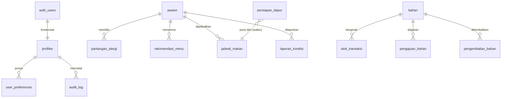

# 03 — Skema Database

DBMS: **PostgreSQL di Supabase** (keputusan K1). Kredensial login dikelola **Supabase Auth**; tabel aplikasi berada di skema `public`. Semua akses data lewat backend Node.js (bukan langsung dari browser).

## 1. Prinsip desain

1. **Bentuk data mengikuti frontend** (tipe, enum, aturan unik). Lihat `01-analisis-frontend.md`.
2. Relasi memakai `pasien_id` / `bahan_id` (FK), sedangkan API tetap mengekspos nama (`pasien`, `bahan`). Penerjemahan dilakukan di lapisan serializer.
3. Enum disimpan sebagai `text` + `CHECK` (bukan tipe ENUM) agar mudah diubah.
4. `kategori` dan `satuan` bahan: teks bebas yang divalidasi di aplikasi (gabungan opsi dua halaman).
5. Status bahan **tidak disimpan**; dihitung dari stok, minimum, dan kedaluwarsa.
6. Jam disimpan sebagai `time`, dikirim `HH:MM`. Angka `numeric` dikirim sebagai number.
7. Zona waktu aplikasi `Asia/Jakarta`. Jangan mengandalkan `SET timezone` (tidak andal lewat connection pooler Supabase); hitung "hari ini" dengan `(now() AT TIME ZONE 'Asia/Jakarta')::date`.
8. **Soft delete** (keputusan K2): tabel data inti punya `deleted_at`/`deleted_by`. API `DELETE` hanya mengisi kolom itu; semua pembacaan menyaring `deleted_at IS NULL`. Tidak ada hapus permanen dari API.
9. Indeks unik bersifat **parsial** (`WHERE deleted_at IS NULL`) agar RM, nama bahan, dan jadwal yang sudah dihapus lunak dapat dipakai ulang.
10. **RLS aktif di semua tabel tanpa policy** untuk `anon` dan `authenticated`: Supabase otomatis membuka tabel `public` lewat PostgREST, jadi tanpa ini data pasien bisa dibaca memakai anon key. Backend memakai koneksi langsung / `service_role` (melewati RLS).

## 2. ERD



## 3. DDL (PostgreSQL)

```sql
-- Migrasi Supabase (supabase/migrations/..._init.sql). gen_random_uuid() sudah bawaan PostgreSQL 13+.

-- ---------- Akun ----------
-- Email dan kata sandi ada di auth.users (Supabase Auth). Tabel ini menyimpan peran dan profil.
CREATE TABLE profiles (
  id         uuid PRIMARY KEY REFERENCES auth.users(id) ON DELETE CASCADE,
  role       text NOT NULL CHECK (role IN ('logistik','ahli-gizi','perawat','waiter')),
  username   text NOT NULL,
  nama       text NOT NULL,
  telepon    text NOT NULL DEFAULT '',
  aktif      boolean NOT NULL DEFAULT true,
  created_at timestamptz NOT NULL DEFAULT now(),
  updated_at timestamptz NOT NULL DEFAULT now()
);
CREATE UNIQUE INDEX profiles_username_uq ON profiles (lower(username));

CREATE TABLE user_preferences (
  user_id uuid NOT NULL REFERENCES profiles(id) ON DELETE CASCADE,
  kunci   text NOT NULL CHECK (kunci IN ('pasien','kondisi','stok','jadwal','distribusi')),
  aktif   boolean NOT NULL DEFAULT false,
  PRIMARY KEY (user_id, kunci)
);

-- ---------- Pasien dan gizi ----------
CREATE TABLE pasien (
  id        uuid PRIMARY KEY DEFAULT gen_random_uuid(),
  nama      text NOT NULL,
  rm        text NOT NULL,
  ruangan   text NOT NULL,
  diagnosis text NOT NULL,
  usia      smallint     NOT NULL CHECK (usia BETWEEN 0 AND 120),
  bb        numeric(6,2) NOT NULL CHECK (bb >= 1),
  tb        numeric(6,2) NOT NULL CHECK (tb >= 30),
  kalori    integer      NOT NULL CHECK (kalori BETWEEN 500 AND 5000),
  tekstur   text NOT NULL CHECK (tekstur IN ('Biasa','Lunak','Bubur','Cair')),
  status    text NOT NULL DEFAULT 'Aktif' CHECK (status IN ('Aktif','Evaluasi','Pulang')),
  created_at timestamptz NOT NULL DEFAULT now(),
  updated_at timestamptz NOT NULL DEFAULT now(),
  deleted_at timestamptz,
  deleted_by uuid REFERENCES profiles(id) ON DELETE SET NULL
);
CREATE UNIQUE INDEX pasien_rm_uq ON pasien (lower(rm)) WHERE deleted_at IS NULL;   -- BR-1
CREATE INDEX pasien_nama_idx ON pasien (lower(nama)) WHERE deleted_at IS NULL;

CREATE TABLE pantangan_alergi (
  id         uuid PRIMARY KEY DEFAULT gen_random_uuid(),
  pasien_id  uuid NOT NULL REFERENCES pasien(id) ON DELETE RESTRICT,
  alergi     text NOT NULL DEFAULT '-',
  pantangan  text NOT NULL,
  catatan    text NOT NULL DEFAULT '',
  created_at timestamptz NOT NULL DEFAULT now(),
  updated_at timestamptz NOT NULL DEFAULT now(),
  deleted_at timestamptz,
  deleted_by uuid REFERENCES profiles(id) ON DELETE SET NULL
);
CREATE INDEX pantangan_pasien_idx ON pantangan_alergi (pasien_id) WHERE deleted_at IS NULL;

CREATE TABLE rekomendasi_menu (
  id         uuid PRIMARY KEY DEFAULT gen_random_uuid(),
  tanggal    date NOT NULL,
  pasien_id  uuid NOT NULL REFERENCES pasien(id) ON DELETE RESTRICT,
  waktu      text NOT NULL CHECK (waktu IN ('Sarapan','Makan siang','Makan malam','Snack')),
  tekstur    text NOT NULL CHECK (tekstur IN ('Biasa','Lunak','Bubur','Cair')),
  kalori     integer NOT NULL CHECK (kalori BETWEEN 50 AND 3000),
  diet       text NOT NULL CHECK (diet IN ('Diet Normal','Diet Diabetes','Diet Rendah Garam','Diet Khusus')),
  menu       text NOT NULL,
  komposisi  text NOT NULL,
  catatan    text NOT NULL DEFAULT '',
  status     text NOT NULL DEFAULT 'Draf' CHECK (status IN ('Draf','Dikirim','Evaluasi')),
  created_by uuid REFERENCES profiles(id) ON DELETE SET NULL,
  created_at timestamptz NOT NULL DEFAULT now(),
  updated_at timestamptz NOT NULL DEFAULT now(),
  deleted_at timestamptz,
  deleted_by uuid REFERENCES profiles(id) ON DELETE SET NULL
);
CREATE INDEX rekomendasi_tanggal_idx ON rekomendasi_menu (tanggal DESC) WHERE deleted_at IS NULL;
CREATE INDEX rekomendasi_pasien_idx  ON rekomendasi_menu (pasien_id) WHERE deleted_at IS NULL;

CREATE TABLE jadwal_makan (
  id         uuid PRIMARY KEY DEFAULT gen_random_uuid(),
  pasien_id  uuid NOT NULL REFERENCES pasien(id) ON DELETE RESTRICT,
  waktu      text NOT NULL CHECK (waktu IN ('Sarapan','Makan siang','Makan malam','Snack')),
  menu       text NOT NULL,
  jam        time NOT NULL,
  status     text NOT NULL DEFAULT 'Terjadwal' CHECK (status IN ('Terjadwal','Menunggu','Terkirim')),
  created_at timestamptz NOT NULL DEFAULT now(),
  updated_at timestamptz NOT NULL DEFAULT now(),
  deleted_at timestamptz,
  deleted_by uuid REFERENCES profiles(id) ON DELETE SET NULL
);
CREATE UNIQUE INDEX jadwal_pasien_waktu_uq ON jadwal_makan (pasien_id, waktu) WHERE deleted_at IS NULL;  -- BR-2

CREATE TABLE laporan_kondisi (                                      -- store frontend: 'perawat'
  id         uuid PRIMARY KEY DEFAULT gen_random_uuid(),
  pasien_id  uuid NOT NULL REFERENCES pasien(id) ON DELETE RESTRICT,
  info       text NOT NULL,
  tanggal    date NOT NULL,
  waktu      time NOT NULL,
  status     text NOT NULL DEFAULT 'Baru' CHECK (status IN ('Baru','Evaluasi','Ditinjau')),
  created_by uuid REFERENCES profiles(id) ON DELETE SET NULL,
  created_at timestamptz NOT NULL DEFAULT now(),
  updated_at timestamptz NOT NULL DEFAULT now(),
  deleted_at timestamptz,
  deleted_by uuid REFERENCES profiles(id) ON DELETE SET NULL
);
CREATE INDEX laporan_pasien_idx ON laporan_kondisi (pasien_id) WHERE deleted_at IS NULL;

-- ---------- Persediaan ----------
CREATE TABLE bahan (
  id          uuid PRIMARY KEY DEFAULT gen_random_uuid(),
  nama        text NOT NULL,
  kategori    text NOT NULL,
  stok        numeric(12,2) NOT NULL CHECK (stok >= 0),
  satuan      text NOT NULL,
  minimum     numeric(12,2) NOT NULL CHECK (minimum >= 0),
  kedaluwarsa date NOT NULL,
  created_at  timestamptz NOT NULL DEFAULT now(),
  updated_at  timestamptz NOT NULL DEFAULT now(),
  deleted_at  timestamptz,
  deleted_by  uuid REFERENCES profiles(id) ON DELETE SET NULL
);
CREATE UNIQUE INDEX bahan_nama_uq ON bahan (lower(nama)) WHERE deleted_at IS NULL;   -- keputusan K5

-- Tabel riwayat logistik bersifat append-only (tanpa hapus dari API).
CREATE TABLE stok_transaksi (
  id         uuid PRIMARY KEY DEFAULT gen_random_uuid(),
  tanggal    date NOT NULL DEFAULT (now() AT TIME ZONE 'Asia/Jakarta')::date,
  bahan_id   uuid NOT NULL REFERENCES bahan(id) ON DELETE RESTRICT,
  jenis      text NOT NULL CHECK (jenis IN ('Masuk','Keluar')),
  jumlah     numeric(12,2) NOT NULL CHECK (jumlah > 0),
  satuan     text NOT NULL,
  keterangan text NOT NULL DEFAULT '',
  created_by uuid REFERENCES profiles(id) ON DELETE SET NULL,
  created_at timestamptz NOT NULL DEFAULT now()
);
CREATE INDEX stok_tanggal_idx ON stok_transaksi (tanggal DESC);

CREATE SEQUENCE pengajuan_kode_seq START 1;
CREATE TABLE pengajuan_bahan (
  id                uuid PRIMARY KEY DEFAULT gen_random_uuid(),
  kode              text NOT NULL UNIQUE DEFAULT ('PG-' || lpad(nextval('pengajuan_kode_seq')::text, 3, '0')),
  tanggal           date NOT NULL DEFAULT (now() AT TIME ZONE 'Asia/Jakarta')::date,
  bahan_id          uuid NOT NULL REFERENCES bahan(id) ON DELETE RESTRICT,
  jumlah            numeric(12,2) NOT NULL CHECK (jumlah > 0),
  satuan            text NOT NULL,
  tanggal_kebutuhan date,
  alasan            text NOT NULL DEFAULT '',
  status            text NOT NULL DEFAULT 'Menunggu' CHECK (status IN ('Menunggu','Disetujui')),
  disetujui_oleh    uuid REFERENCES profiles(id) ON DELETE SET NULL,   -- K6: hanya peran logistik
  created_by        uuid REFERENCES profiles(id) ON DELETE SET NULL,
  created_at        timestamptz NOT NULL DEFAULT now(),
  updated_at        timestamptz NOT NULL DEFAULT now()
);

CREATE TABLE pengembalian_bahan (
  id         uuid PRIMARY KEY DEFAULT gen_random_uuid(),
  tanggal    date NOT NULL DEFAULT (now() AT TIME ZONE 'Asia/Jakarta')::date,
  bahan_id   uuid NOT NULL REFERENCES bahan(id) ON DELETE RESTRICT,
  jumlah     numeric(12,2) NOT NULL CHECK (jumlah > 0),
  satuan     text NOT NULL,
  kondisi    text NOT NULL CHECK (kondisi IN ('Layak digunakan','Perlu diperiksa','Tidak layak')),
  alasan     text NOT NULL DEFAULT '',
  status     text NOT NULL CHECK (status IN ('Diterima','Pemeriksaan','Dipisahkan')),
  created_by uuid REFERENCES profiles(id) ON DELETE SET NULL,
  created_at timestamptz NOT NULL DEFAULT now()
);

CREATE TABLE persiapan_dapur (
  id       uuid PRIMARY KEY DEFAULT gen_random_uuid(),
  tanggal  date NOT NULL,
  waktu    text NOT NULL CHECK (waktu IN ('Sarapan','Makan siang','Makan malam','Snack')),
  porsi    integer NOT NULL DEFAULT 0 CHECK (porsi >= 0),
  status   text NOT NULL DEFAULT 'Menunggu' CHECK (status IN ('Selesai','Diproses','Menunggu')),
  progres  smallint NOT NULL DEFAULT 0 CHECK (progres BETWEEN 0 AND 100),
  catatan  text NOT NULL DEFAULT '',
  updated_at timestamptz NOT NULL DEFAULT now(),
  UNIQUE (tanggal, waktu)
);

-- ---------- Audit (disarankan untuk data pasien) ----------
CREATE TABLE audit_log (
  id         bigserial PRIMARY KEY,
  user_id    uuid REFERENCES profiles(id) ON DELETE SET NULL,
  role       text,
  aksi       text NOT NULL CHECK (aksi IN ('create','update','delete','restore','login','reset')),
  entitas    text NOT NULL,
  entitas_id text,
  sebelum    jsonb,
  sesudah    jsonb,
  waktu      timestamptz NOT NULL DEFAULT now()
);

-- ---------- updated_at otomatis ----------
CREATE OR REPLACE FUNCTION set_updated_at() RETURNS trigger
LANGUAGE plpgsql SET search_path = '' AS $$
BEGIN NEW.updated_at = now(); RETURN NEW; END $$;
-- Pasang trigger BEFORE UPDATE pada: profiles, pasien, pantangan_alergi, rekomendasi_menu,
-- jadwal_makan, laporan_kondisi, bahan, pengajuan_bahan, persiapan_dapur.

-- ---------- Soft delete atomik untuk pasien (dan turunannya) ----------
CREATE OR REPLACE FUNCTION soft_delete_pasien(p_id uuid, p_user uuid) RETURNS void
LANGUAGE plpgsql SET search_path = public AS $$
DECLARE v_ts timestamptz := now();
BEGIN
  UPDATE pantangan_alergi SET deleted_at = v_ts, deleted_by = p_user WHERE pasien_id = p_id AND deleted_at IS NULL;
  UPDATE rekomendasi_menu SET deleted_at = v_ts, deleted_by = p_user WHERE pasien_id = p_id AND deleted_at IS NULL;
  UPDATE jadwal_makan     SET deleted_at = v_ts, deleted_by = p_user WHERE pasien_id = p_id AND deleted_at IS NULL;
  UPDATE laporan_kondisi  SET deleted_at = v_ts, deleted_by = p_user WHERE pasien_id = p_id AND deleted_at IS NULL;
  UPDATE pasien           SET deleted_at = v_ts, deleted_by = p_user WHERE id = p_id AND deleted_at IS NULL;
END $$;

-- Pulihkan pasien beserta turunan yang ikut terhapus bersamanya (timestamp sama).
-- Gagal bila RM/jadwal bentrok dengan data aktif (indeks unik parsial) — ditangani sebagai 409.
CREATE OR REPLACE FUNCTION restore_pasien(p_id uuid) RETURNS void
LANGUAGE plpgsql SET search_path = public AS $$
DECLARE v_ts timestamptz;
BEGIN
  SELECT deleted_at INTO v_ts FROM pasien WHERE id = p_id;
  IF v_ts IS NULL THEN RETURN; END IF;
  UPDATE pasien           SET deleted_at = NULL, deleted_by = NULL WHERE id = p_id;
  UPDATE pantangan_alergi SET deleted_at = NULL, deleted_by = NULL WHERE pasien_id = p_id AND deleted_at = v_ts;
  UPDATE rekomendasi_menu SET deleted_at = NULL, deleted_by = NULL WHERE pasien_id = p_id AND deleted_at = v_ts;
  UPDATE jadwal_makan     SET deleted_at = NULL, deleted_by = NULL WHERE pasien_id = p_id AND deleted_at = v_ts;
  UPDATE laporan_kondisi  SET deleted_at = NULL, deleted_by = NULL WHERE pasien_id = p_id AND deleted_at = v_ts;
END $$;

-- ---------- Keamanan: RLS aktif, tanpa policy untuk anon/authenticated ----------
ALTER TABLE profiles           ENABLE ROW LEVEL SECURITY;
ALTER TABLE user_preferences   ENABLE ROW LEVEL SECURITY;
ALTER TABLE pasien             ENABLE ROW LEVEL SECURITY;
ALTER TABLE pantangan_alergi   ENABLE ROW LEVEL SECURITY;
ALTER TABLE rekomendasi_menu   ENABLE ROW LEVEL SECURITY;
ALTER TABLE jadwal_makan       ENABLE ROW LEVEL SECURITY;
ALTER TABLE laporan_kondisi    ENABLE ROW LEVEL SECURITY;
ALTER TABLE bahan              ENABLE ROW LEVEL SECURITY;
ALTER TABLE stok_transaksi     ENABLE ROW LEVEL SECURITY;
ALTER TABLE pengajuan_bahan    ENABLE ROW LEVEL SECURITY;
ALTER TABLE pengembalian_bahan ENABLE ROW LEVEL SECURITY;
ALTER TABLE persiapan_dapur    ENABLE ROW LEVEL SECURITY;
ALTER TABLE audit_log          ENABLE ROW LEVEL SECURITY;
REVOKE ALL ON ALL TABLES    IN SCHEMA public FROM anon, authenticated;
REVOKE ALL ON ALL SEQUENCES IN SCHEMA public FROM anon, authenticated;
REVOKE EXECUTE ON FUNCTION soft_delete_pasien(uuid, uuid), restore_pasien(uuid) FROM PUBLIC, anon, authenticated;
ALTER DEFAULT PRIVILEGES IN SCHEMA public REVOKE ALL ON TABLES FROM anon, authenticated;
```

## 4. Pemetaan store frontend → tabel → serializer

| Store / resource API | Tabel | Pemetaan khusus |
|---|---|---|
| `pasien` | `pasien` | `bb`, `tb` numeric → number; `DELETE` = `soft_delete_pasien()` |
| `pantangan` | `pantangan_alergi` | `pasien` = `pasien.nama` lewat join |
| `rekomendasi` | `rekomendasi_menu` | `pasien` = nama; `tanggal` → `YYYY-MM-DD` |
| `jadwal` | `jadwal_makan` | `jam` → `HH:MM`; `pasien` = nama |
| `perawat` | `laporan_kondisi` | `waktu` → `HH:MM`; `pasien` = nama |
| `bahan` | `bahan` | numeric → number; `kedaluwarsa` → `YYYY-MM-DD` |
| `/api/logistik/stok` | `stok_transaksi` | `bahan` = nama |
| `/api/logistik/pengajuan` | `pengajuan_bahan` | `tanggalKebutuhan` ← `tanggal_kebutuhan` |
| `/api/logistik/pengembalian` | `pengembalian_bahan` | `status` diturunkan dari `kondisi` |
| `/api/logistik/persiapan` | `persiapan_dapur` | selalu 4 slot per tanggal |

Nama kolom database `snake_case`, JSON API `camelCase` hanya untuk `tanggalKebutuhan`; field lain sudah satu kata sehingga identik dengan frontend.

## 5. Data awal (seed) — disalin dari frontend

Tanggal relatif terhadap hari seed (`current_date`), sama seperti `NC.day(n)`.

**pasien**

| nama | rm | ruangan | diagnosis | usia | bb | tb | kalori | tekstur | status |
|---|---|---|---|---|---|---|---|---|---|
| Andi Pratama | RM00124 | Melati 102 | Pasca operasi | 35 | 65 | 170 | 1800 | Biasa | Aktif |
| Siti Rahma | RM00125 | Mawar 205 | Diabetes | 52 | 70 | 160 | 1500 | Lunak | Evaluasi |
| Budi Santoso | RM00126 | Anggrek 301 | Hipertensi | 58 | 78 | 168 | 1700 | Biasa | Aktif |
| Dewi Lestari | RM00127 | Melati 105 | Gangguan pencernaan | 41 | 55 | 158 | 1600 | Bubur | Aktif |

**pantangan_alergi**: Siti Rahma (`-`, Makanan tinggi gula, Perhatikan asupan karbohidrat); Budi Santoso (Udang, Makanan tinggi garam, Perhatikan kandungan natrium); Dewi Lestari (Susu sapi, Makanan pemicu keluhan, Sesuaikan toleransi pasien).

**rekomendasi_menu**
| tanggal | pasien | waktu | tekstur | kalori | diet | menu | komposisi | catatan | status |
|---|---|---|---|---|---|---|---|---|---|
| hari ini | Andi Pratama | Sarapan | Biasa | 500 | Diet Normal | Nasi ayam kukus | Nasi, ayam kukus, wortel, dan sayuran pendamping. | | Dikirim |
| hari ini | Siti Rahma | Makan siang | Lunak | 450 | Diet Diabetes | Menu diet diabetes | Nasi merah, ikan panggang, tumis buncis. | Tanpa gula tambahan | Evaluasi |
| kemarin | Budi Santoso | Makan malam | Biasa | 520 | Diet Rendah Garam | Ikan kukus rendah garam | Ikan kukus, kentang, dan sayuran. | | Dikirim |
| kemarin | Dewi Lestari | Sarapan | Bubur | 400 | Diet Normal | Bubur ayam | Bubur nasi, ayam suwir, dan sayuran. | | Dikirim |

**jadwal_makan**: Andi Pratama / Sarapan / Nasi ayam kukus / 06:00 / Terjadwal; Siti Rahma / Makan siang / Menu diet diabetes / 11:00 / Menunggu; Budi Santoso / Makan malam / Ikan kukus rendah garam / 17:00 / Terjadwal.

**laporan_kondisi** (tanggal hari ini): Siti Rahma / Nafsu makan menurun / 08:15 / Evaluasi; Andi Pratama / Kondisi stabil / 08:30 / Baru; Dewi Lestari / Keluhan mual setelah makan / 09:00 / Evaluasi.

**bahan**
| nama | kategori | stok | satuan | minimum | kedaluwarsa |
|---|---|---|---|---|---|
| Beras | Karbohidrat | 125 | kg | 50 | hari ini + 240 |
| Tomat | Sayuran | 8 | kg | 15 | hari ini + 8 |
| Wortel | Sayuran | 6 | kg | 12 | hari ini + 14 |
| Daging ayam | Protein | 22 | kg | 10 | hari ini + 5 |
| Telur | Protein | 0 | butir | 60 | hari ini + 21 |

Seed tambahan untuk modul logistik (opsional, dari tabel statis): riwayat stok (Beras Masuk 50 kg, Tomat Keluar 5 kg, Daging ayam Keluar 12 kg), pengajuan PG-001..003, pengembalian (Beras 3 kg Layak, Wortel 2 kg Perlu diperiksa, Tomat 1 kg Tidak layak), persiapan dapur (Sarapan 120/Selesai/100%, Makan siang 140/Diproses/65%, Makan malam 110/Menunggu/0%, Snack 80/Menunggu/0%).

**Akun demo** (dibuat lewat Supabase Auth Admin API, lalu baris `profiles`): satu akun per peran; username `logistik`, `ahli-gizi`, `perawat`, `waiter`; email `<username-tanpa-strip>@nutricare.com` (ahli gizi memakai `ahligizi@nutricare.com`, sesuai default di frontend); nama `Petugas Logistik`, `Ahli Gizi`, `Perawat`, `Waiter`. Kata sandi dibaca dari variabel lingkungan `SEED_DEMO_PASSWORD` (jangan ditulis di repositori). `email_confirm: true` agar bisa langsung login.

## 6. Aturan integritas yang ditegakkan di database

| Aturan | Mekanisme |
|---|---|
| RM unik tanpa peduli huruf (di antara pasien aktif) | `UNIQUE INDEX (lower(rm)) WHERE deleted_at IS NULL` |
| Satu jadwal per pasien per waktu (di antara jadwal aktif) | `UNIQUE INDEX (pasien_id, waktu) WHERE deleted_at IS NULL` |
| Stok tidak negatif | `CHECK (stok >= 0)` + transaksi |
| Nama bahan unik (di antara bahan aktif) | `UNIQUE INDEX (lower(nama)) WHERE deleted_at IS NULL` |
| Hapus pasien menyembunyikan data turunan (soft delete, K2) | fungsi `soft_delete_pasien()` dalam satu transaksi; FK turunan `ON DELETE RESTRICT` mencegah hapus permanen tak sengaja |
| Tabel anon/authenticated tidak bisa dibaca langsung dari Supabase | RLS aktif tanpa policy + `REVOKE ALL` |
| Riwayat transaksi tetap utuh walau bahan dihapus | Bahan hanya soft delete; `stok_transaksi`, `pengajuan_bahan`, `pengembalian_bahan` tetap mereferensikannya (`ON DELETE RESTRICT`) |

Aturan yang butuh logika aplikasi (bukan constraint): BR-3 (alergi), BR-4 (stok habis), penurunan status pengembalian, kode pengajuan.

## 7. Migrasi (Supabase CLI)

- Lokasi: `supabase/migrations/YYYYMMDDHHMMSS_deskripsi.sql`, dibuat dengan `supabase migration new <nama>`; uji lokal dengan `supabase db reset`.
- Migrasi tidak boleh mengubah bentuk data yang dilihat frontend tanpa memperbarui `02-kontrak-api.md` dan tes kontrak.
- Seed demo dipisah dari migrasi skema (`supabase/seed.sql` hanya untuk data tabel; akun Auth dibuat oleh skrip `server/seeds/` lewat Admin API) supaya produksi tidak ikut terisi data contoh.
- Jangan pernah menaruh `service_role` key di frontend atau repositori.
